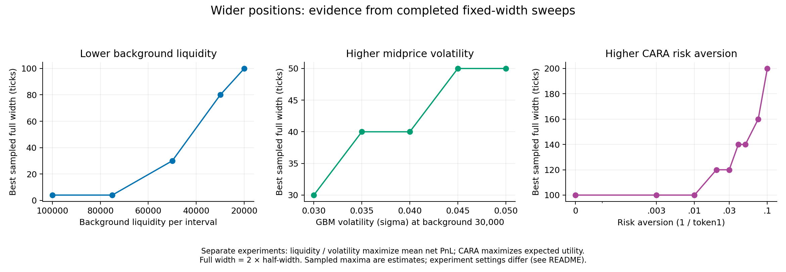

# Drivers of wider LP positions

This collection brings together completed sweeps of **background liquidity**,
**midprice volatility**, and **CARA risk aversion**. It contains copies of the
recorded results, configurations, path-level data, and plots; no simulations
were rerun to assemble it.

The results support wider positions as background liquidity falls, volatility
rises at background liquidity 30,000, and risk aversion rises in the CARA
experiment.

| Driver | Main comparison | Best sampled half-width (ticks) | What is maximized? |
| --- | --- | --- | --- |
| [Background liquidity](background-liquidity/README.md) | 100,000 → 20,000 per interval, at sigma 0.07 | 2 → 50 | Mean net PnL |
| [Midprice volatility](volatility/README.md) | Sigma 0.03 → 0.05, at background 30,000 | 15 → 25 | Mean net PnL |
| [CARA risk aversion](risk-aversion/README.md) | `risk_aversion` 0 → 0.1, at sigma 0.03 and background 30,000 | 50 → 100 | Expected utility / certainty-equivalent PnL |



## Reading the evidence

A symmetric half-width `w` means offsets `[-w, +w]` and a full span of `2*w`
ticks. The figure and [combined CSV](overview.csv) use **full widths**. The
driver tables explicitly label half-widths or full widths.

Fixed-width sweeps compare periodic baseline policies and report the best
**sampled** width. PPO sweeps report average deployed full width, including
out-of-range positions but excluding non-deployment; this is policy behavior,
not a proven optimal fixed width. The CSV's `width_statistic`, `objective`, and
`source_csv` columns keep those meanings explicit. A smaller loss can be the
best result: “best” does not always mean positive PnL.

CARA changes the ranking of a given set of PnL distributions. Increasing
`risk_aversion` does not itself raise a fixed policy's monetary profit. For
terminal PnL `G` and positive `a`, maximizing mean utility is equivalent to
maximizing `CE = -log(mean(exp(-a*G))) / a`; at `a=0`, CE is mean PnL.

## Collection layout

```text
background-liquidity/
  fixed-width/             PnL versus width at five background levels
  ppo/                     Learned widths at five background levels
  periodic-comparison/     Baselines matched to learned average widths
volatility/
  fixed-width-bg30000/     PnL versus width, sigma 0.03–0.05
  ppo/                     Three training seeds, with baseline comparisons
risk-aversion/
  cara/                    2026-11-10 run: 5,000 paths per width
manifest.json              Original locations and SHA-256 checksums
overview.csv               Derived results with source CSV references
overview.png / .pdf        Combined fixed-width comparison
summarize_results.py        Verify snapshots and rebuild the overview
```

## Comparability and uncertainty

All main fixed-width sweeps start with 1,000 token1, horizon 1, gross trade
size 250 token1, arrival-rate parameter 300 per side, and gas cost 2. Their
other settings differ:

| Evidence | Simulator steps | Rebalance / decision interval | Evaluated paths per condition | Objective / policy |
| --- | ---: | ---: | ---: | --- |
| Liquidity and volatility fixed-width grids | 10,000 | Every 100 steps (0.01 time units) | 100 in one batch | Net PnL, periodic |
| Liquidity PPO | 1,000 | Decision every 100 steps; holds allowed | 10 × 100 per policy; 1 training seed | Running inventory penalty, `phi=0.4` |
| Volatility PPO | 10,000 | Rebalance every 100 steps | 10 × 100 per policy; 3 training seeds | Net PnL, `phi=0` |
| CARA grid | 1,000 | Every 100 steps (0.1 time units) | 50 × 100 | Expected CARA utility, periodic |

The fixed PnL grids use matched external shocks and retain individual PnLs;
their path dispersion is not a confidence interval for the selected optimum.
Although their configuration files contain `n_eval_episodes=10`, these grid
artifacts contain one batch of 100 paths per cell. The CARA run uses a paired
episode-batch bootstrap with 95% pointwise intervals. PPO standard deviations
describe variation across training seeds, not confidence intervals for an
optimal width. The liquidity PPO run has only one training seed.

Compare levels **within** each sweep. Cadence, policy class, training objective,
evaluation seeds, and code history prevent treating this collection as one
controlled three-factor experiment. Original configurations are authoritative;
current simulator defaults should not be substituted for them.

## Provenance and rebuilding

[manifest.json](manifest.json) records six source result directories from the
main checkout, with byte counts and SHA-256 checksums for every copied artifact.
Original files remain in place. Historical output paths and metadata inside
the snapshots are preserved, so use the collection's relative links for local
navigation. Recorded Git revisions are retained where
available; a source revision was not recorded for every run.

Model checkpoints and normalization pickles remain at the original locations.
Redundant per-episode CARA NPZ files are omitted because each run's
`path_results.npz` retains the combined PnL and reward arrays and
`episode_diagnostics.csv` retains episode diagnostics. The manifest lists these
omissions. The incomplete early CARA run is excluded explicitly. Unrelated
price-path, trade-size, and action-space experiments are outside this collection.

From the repository root:

```bash
python experiments/wider-positions-drivers/summarize_results.py
# Verify snapshots and rebuild the CSV without matplotlib:
python experiments/wider-positions-drivers/summarize_results.py --no-plots
```

This only reads the saved evidence and rewrites the overview artifacts. For new
CARA simulations, use [the existing sweep runner](../sweep_dense_exponential_width.py)
with explicit settings and a fresh output directory; the exact original
configuration is in [cara/config.json](risk-aversion/cara/config.json).
