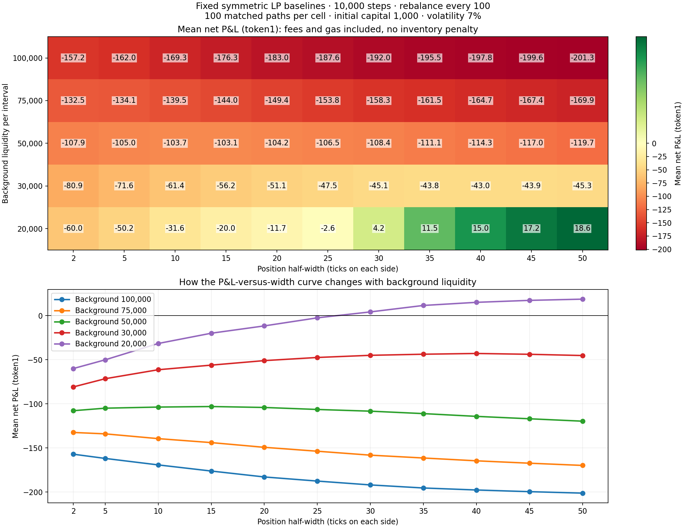

# Background liquidity

Lower background liquidity shifts the best sampled periodic position toward
wider ranges in the saved fixed-width sweep. The PPO sweep also selects wider
positions overall at lower background liquidity.

## Fixed-width PnL evidence

Source: [summary.csv](fixed-width/summary.csv), [full results](fixed-width/summary.json),
and [per-path PnL](fixed-width/pnl_by_path.npz). Sigma is 0.07; each cell has
100 matched paths, 10,000 steps, and rebalancing every 100 steps. The tested
half-widths are `2, 5, 10, 15, 20, 25, 30, 35, 40, 45, 50`.

| Background liquidity per interval | Best sampled half-width | Mean net PnL (token1) |
| ---: | ---: | ---: |
| 100,000 | 2 | -157.168 |
| 75,000 | 2 | -132.521 |
| 50,000 | 15 | -103.118 |
| 30,000 | 40 | -42.961 |
| 20,000 | 50 | 18.627 |

Only the 20,000-background case has positive mean PnL on this grid, at
half-widths 30–50. Its best sampled width is the upper grid boundary, so the
sweep does not locate an interior maximum. Net PnL includes fees and gas;
the reported inventory penalty is not subtracted from this comparison.

## Learned-policy evidence

Source: [width summary](ppo/width_by_background_liquidity.csv),
[per-seed results](ppo/per_seed.csv), and [settings](ppo/sweep_config.json).
These policies use sigma 0.03, 1,000 simulator steps, decisions every 100 steps,
and a running inventory penalty with `phi=0.4`. They can hold or choose
asymmetric positions. Each final policy is evaluated on 1,000 paths.

| Background liquidity | Mean deployed full width (ticks) | Mean PnL (token1) |
| ---: | ---: | ---: |
| 10,000 | 93.7780 | 223.331 |
| 15,000 | 86.2495 | 181.500 |
| 20,000 | 85.8090 | 153.118 |
| 25,000 | 77.4060 | 134.293 |
| 30,000 | 77.6935 | 119.384 |

There is a small reversal between 25,000 and 30,000, so the learned-width trend
is not strictly monotone. With only training seed 42, seed uncertainty is
unavailable. These widths describe deployed policies, not a fixed-width PnL
optimum. [Matched-width periodic comparisons](periodic-comparison/comparison.csv)
retain the associated fees, gas, PnL, inventory penalty, and rebalance counts.

The mechanism suggested by the model is a change in both price impact and fee
competition as background depth falls. The fixed-width sweep varies background
liquidity while holding the other settings fixed; it does not separately
identify those two channels.
