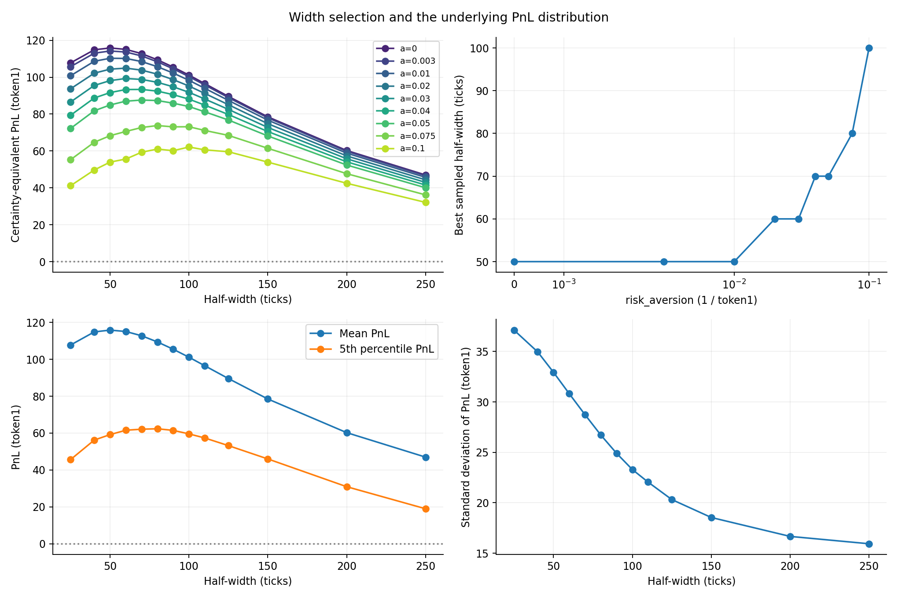

# CARA risk aversion

How much mean profit would an LP give up for a less variable outcome? Keep
the market fixed at background liquidity 30,000 and volatility 0.03. Simulate
each periodic policy once, then change the LP's **constant absolute risk aversion**
(CARA) when scoring its recorded wealth paths. The LP recenters every 0.1 time
units and starts with 1,000 token1.

## Comparing two payoff distributions

A **certainty equivalent** (CE) is the sure PnL the LP values as highly as a
policy's risky PnL. At zero risk aversion it equals mean PnL. Higher positive
risk aversion puts more weight on the least favorable outcomes.

| Fixed range around the pool price | Mean PnL, also CE at zero risk aversion | PnL standard deviation | CE at risk aversion 0.1 |
| --- | ---: | ---: | ---: |
| ±50 ticks | 115.85 | 32.95 | 53.97 |
| ±100 ticks | 101.15 | 23.30 | 62.15 |

All amounts are in token1. Widening costs about 15 token1 in mean PnL and
reduces its standard deviation by about 10. An LP with risk aversion 0.1 values
the wider payoff at 62.15 token1 for certain, about 8 more than the narrower
payoff. The simulation measures how preferences change the ranking of **fixed policies**.
[Scores for every risk and width](cara/reward_grid.csv) · [Per-path payoffs](cara/path_results.npz)

## How the code scores risk

The periodic agent's actions depend on the pool tick and its rebalance schedule.
This lets the runner replay the production reward on identical wealth paths at
each risk aversion. For terminal net PnL `G` and positive risk aversion `a`
(in 1/token1), the estimated certainty equivalent is
`-log(mean(exp(-a * G))) / a`. At any fixed `a`, maximizing CE gives the same
ranking as maximizing mean CARA utility. [Sweep runner](../../sweep_dense_exponential_width.py) ·
[Production reward](../../../SAiFE_gym/rewards/RewardFunctions.py)

Across the 13 sampled half-widths from 25 to 250 ticks, each move to the next
wider range gains more or gives up less CE at risk aversion 0.1 than at zero.
Each width has 50 episode batches of 100 trajectories, with the same episode
seeds across widths. The runner resamples paired episode batches 2,000 times.
At risk aversion 0.04,
the leading width wins about 53% of those resamples. At 0.1, one path carries
about 18% of the utility weight at the leading width. These diagnostics matter
when interpreting small differences between nearby widths.
[Recorded settings](cara/config.json) · [Width rankings](cara/best_widths.csv) ·
[Bootstrap and tail diagnostics](cara/summary.json)
