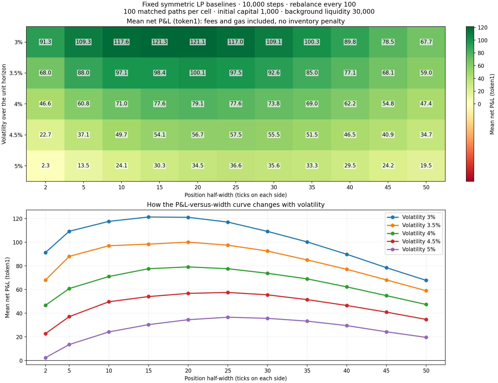

# Midprice volatility

When the external price moves more between rebalances, how much pool price
movement can the LP's range accommodate? Both sweeps hold background liquidity
at 30,000, keep capital and trade size fixed, and recenter every 0.01 time units.
Only the volatility of the external midprice changes between market levels.

## What the trained LPs do

At each volatility, PPO learns how wide a symmetric position to deploy at each
decision. A new policy is trained for each of three seeds. At volatility 0.05,
all three deploy a wider range on average than their counterparts at 0.03. The
mean deployed full width grows from about 42 to 53 ticks, with some reversals
at intermediate levels for individual seeds. The training objective is net
PnL (`inventory_phi=0`). [Mean policy widths](ppo/summary/width_by_volatility.csv) ·
[Individual training seeds](ppo/summary/per_seed.csv) · [Settings](ppo/summary/summary.json)

Each policy is evaluated on 1,000 paths, using the same evaluation seeds as its
periodic comparisons. At all five volatility levels, PPO earns more mean PnL
than the default periodic range of ±50 ticks. A periodic range selected from
the width grid earns more mean PnL than PPO at each level. The learned policies
capture the direction of the shift even with this performance gap.
[Policy comparison on shared evaluation seeds](ppo/periodic_comparison/comparison.csv)

## What widening buys at the same volatility

Choose the same pair of periodic ranges at every level. Each starts with 1,000
token1 and experiences the same external price shocks as the other range.
The pool price can respond differently because each policy supplies a different
amount of liquidity per tick.

| Volatility | Mean net PnL at ±15 (token1) | Mean net PnL at ±25 (token1) | Paths where ±25 earns more, out of 100 |
| ---: | ---: | ---: | ---: |
| 0.030 | 121.33 | 117.03 | 34 |
| 0.035 | 98.40 | 97.50 | 50 |
| 0.040 | 77.61 | 77.60 | 46 |
| 0.045 | 54.05 | 57.53 | 63 |
| 0.050 | 30.32 | 36.60 | 72 |

The comparison is nearly even at 0.04. At 0.05, widening increases time in
range from 59% to 72%. Recorded mean fee income falls from 399 to 386 token1,
and gas spend stays at 198. The remainder of PnL after accounting for those fees
and gas improves from −170 to −152 token1, enough to cover the difference in
fees. This remainder includes inventory and reinvestment valuation effects.
Both ranges are less profitable here than at 0.03.
[Policy diagnostics](fixed-width-bg30000/summary.csv) ·
[Paired path PnLs](fixed-width-bg30000/pnl_by_path.npz)

The full grid covers half-widths of 2, 5, 10, …, 50 ticks, using one batch of
100 trajectories per cell. Of the ten moves to the next wider range, nine give
a larger gain or a smaller loss in mean PnL at volatility 0.05 than at 0.03.
[Full grid and configurations](fixed-width-bg30000/summary.json) ·
[Path and accounting checks](fixed-width-bg30000/validation.json)
